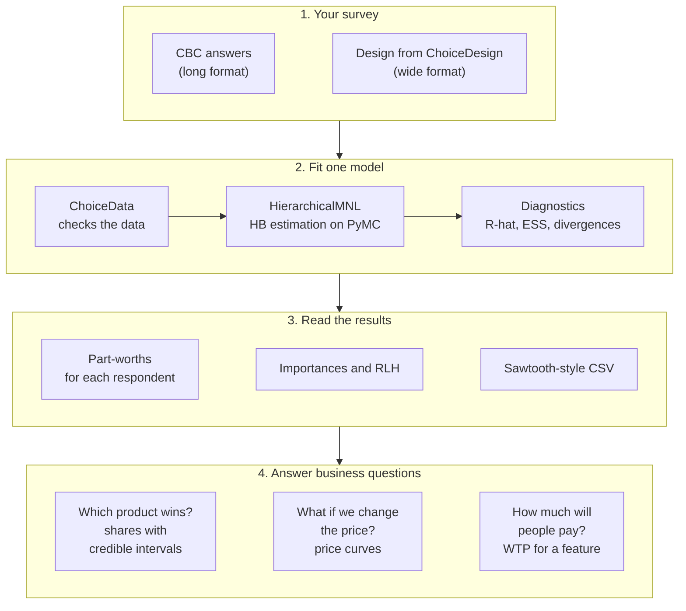

# partworth

partworth estimates hierarchical Bayes (HB) models for choice-based conjoint (CBC)
studies in Python. It is built on [PyMC](https://www.pymc.io/).

It covers the whole workflow in one package: data checks, HB estimation, respondent-level
part-worths, Sawtooth-style output files, a market simulator and willingness to pay (WTP).
The validation scripts and their results are in the repository.

> **Status: pre-alpha.** The API may change.

## What you can do with it



Steps 1 to 3 replace the usual "estimate in one tool, export, simulate in a spreadsheet" work.
Step 4 uses all posterior draws, so every share, price curve and WTP comes with its uncertainty.

## Why partworth

- Sawtooth CBC/HB is commercial and runs outside Python. partworth gives the same kind of
  outputs (raw utilities, zero-centred diffs, importances, RLH) in an open Python package.
- pymc-marketing's `MixedLogit` is a general choice model. partworth is built for CBC
  studies: long-format survey data, correlated random coefficients, a negative price
  coefficient for every respondent, and a simulator with credible intervals.
- Answers come as chances. The simulator uses the same posterior draws (500 by default)
  for every plan, so two plans can be compared draw by draw. You get answers such as "this
  price gives the most profit in 94% of the draws". A spreadsheet simulator gives one share
  per product.
- Each result can be checked. The repository compares partworth with R `bayesm` on public
  data and tests that it recovers known parameters.

## What works now

- Long-format choice data with checks, tasks of different sizes and a none option
- Import of wide designs, such as the output of [ChoiceDesign](https://choicedesign.readthedocs.io/)
- Effects, dummy and linear coding, with an optional sign constraint (for price)
- Hierarchical MNL with correlated coefficients (LKJ prior), respondent covariates and the
  nutpie sampler
- Part-worths, zero-centred diffs, importances, RLH and convergence diagnostics
- Sawtooth-style utilities CSV (read and write)
- Market simulator with credible intervals, price curves and WTP

Not planned: experimental design (use ChoiceDesign),
latent class, MaxDiff and ACBC.

## Installation

```
pip install "partworth[nutpie,datasets]"
```

`nutpie` adds the faster sampler. `datasets` adds the reader for the public camera data.

It needs Python 3.12 or later.

On macOS 26 or later, PyTensor 3.3.3 or earlier can fail with
`ld: library 'd64' not found`. Set `PYTENSOR_FLAGS=cxx=` to avoid it. The fix is merged in
PyTensor ([pymc-devs/pytensor#2432](https://github.com/pymc-devs/pytensor/pull/2432)) but
not yet released.

## Quick look

This example uses simulated data, so you can paste it as it is.

```python
import pandas as pd
import partworth as pw
from partworth.datasets import simulate_cbc

# 300 respondents, 12 tasks, 3 products + "none" per task.
# mu: true population means of the coded coefficients (price on the log scale).
data, truth = simulate_cbc(
    300, 12, 3,
    {"brand": ["A", "B", "C"], "size": ["S", "M", "L"], "price": [2.0, 2.5, 3.0, 3.5]},
    price="price", mu=[0.4, -0.1, -0.3, 0.1, -0.5, -1.0], sd=0.6, seed=1,
)
print(data.describe())                       # how often each level was shown and chosen

# more tuning and draws than the defaults: the SD of "none" mixes slowly (see the guide)
result = pw.HierarchicalMNL(data).fit(draws=2000, tune=3000, chains=4, random_seed=1)
print(result.diagnostics().report())         # R-hat, ESS, divergences, what to try

result.part_worths()                         # raw utilities, one column per level
result.part_worths("zc_diffs")               # zero-centred diffs
result.importances()
result.to_sawtooth_csv("utilities.csv")

scenario = pd.DataFrame({"product": ["Ours", "Theirs"], "brand": ["A", "B"],
                         "size": ["M", "M"], "price": [3.0, 2.5]})
sim = pw.MarketSimulator(result)
print(sim.shares(scenario))                  # shares with 90% credible intervals
print(sim.price_curve(scenario, product="Ours", grid=[2.0, 2.5, 3.0, 3.5]))
print(pw.wtp(result, attribute="size", from_level="S", to_level="L"))
```

For your own data, build `ChoiceData` from a long table (one row per respondent, task and
alternative):

```python
data = pw.ChoiceData.from_long(
    df,                                        # your table
    attributes={"brand": pw.Categorical(["A", "B", "C"]),
                "price": pw.Linear(sign="negative")},
    none="is_none",                            # optional "no purchase" rows
)
```

[examples/retail_survey.ipynb](https://github.com/kojikojikojikoji/partworth/blob/main/examples/retail_survey.ipynb) is a notebook on a dummy retail
survey. It goes from the survey table to shopper differences, prices, profit and a hold-out
check ([open in Colab](https://colab.research.google.com/github/kojikojikojikoji/partworth/blob/main/examples/retail_survey.ipynb)). A Japanese version is in
[examples/retail_survey_ja.ipynb](https://github.com/kojikojikojikoji/partworth/blob/main/examples/retail_survey_ja.ipynb).
[examples/camera.ipynb](https://github.com/kojikojikojikoji/partworth/blob/main/examples/camera.ipynb) runs the main steps on public data from a
published camera study ([Japanese](https://github.com/kojikojikojikoji/partworth/blob/main/examples/camera_ja.ipynb)).
[examples/camera.py](https://github.com/kojikojikojikoji/partworth/blob/main/examples/camera.py) fits the same model on all 16 questions in a short script.
[docs/guide.md](https://github.com/kojikojikojikoji/partworth/blob/main/docs/guide.md) explains the choices you make along the way.

## Validation

Each script in [validation/](https://github.com/kojikojikojikoji/partworth/tree/main/validation/) writes its report to
[validation/results/](https://github.com/kojikojikojikoji/partworth/tree/main/validation/results/).

- **Parameter recovery** ([recovery_report.md](https://github.com/kojikojikojikoji/partworth/blob/main/validation/results/recovery_report.md)).
  300 simulated respondents and 12 tasks. Respondent-level 90% intervals covered 88.7% of
  the true values. 5 of 6 population means and 6 of 6 SDs were inside their 90%
  intervals. The price mean (log scale) was just outside. The convergence targets were met.
  Correlations reached R-hat 1.013 and ESS 399, just short of the targets.
  `pytest --run-slow` runs the same fit and checks.
- **Comparison with R bayesm** ([camera_report.md](https://github.com/kojikojikojikoji/partworth/blob/main/validation/results/camera_report.md)).
  `bayesm::rhierMnlRwMixture` on the public camera data. Respondent-level posterior means
  correlate at 0.997 or more for every coefficient. The hold-out hit rate is 0.729 for
  partworth and 0.730 for bayesm. Population means differ by up to 0.21 posterior SDs.
  Our target was 0.1, so this target is not met. The two packages use different priors.
- **Simulation-based calibration** ([sbc_report.md](https://github.com/kojikojikojikoji/partworth/blob/main/validation/results/sbc_report.md)).
  200 simulated data sets, 8 population parameters. The smallest uniformity p-value was
  0.017. None was below 0.006, the threshold after correcting for 8 tests. Earlier runs
  showed low p-values for different parameters each time. 15 of the 200 fits had a
  population ESS below 99, which weakens the check.
- **Performance** ([performance.md](https://github.com/kojikojikojikoji/partworth/blob/main/validation/results/performance.md)). 300 respondents
  took 74 s and 1,000 respondents took 290 s on one laptop.

## Data and licences

partworth is licensed under Apache-2.0. The `camera` data belongs to the R package
[bayesm](https://cran.r-project.org/package=bayesm), which is GPL. partworth downloads it
from CRAN on first use and never includes it. No bayesm code is used. The comparison runs
R in a separate process.

All examples use public or simulated data.

## How this is built

Design decisions are in [docs/adr/](https://github.com/kojikojikojikoji/partworth/tree/main/docs/adr/). Parts of the code were written with an AI
coding assistant. The model, the priors and the validation targets are the author's
decisions. The ADRs record them.

## Licence

Apache License 2.0. See [LICENSE](https://github.com/kojikojikojikoji/partworth/blob/main/LICENSE).
